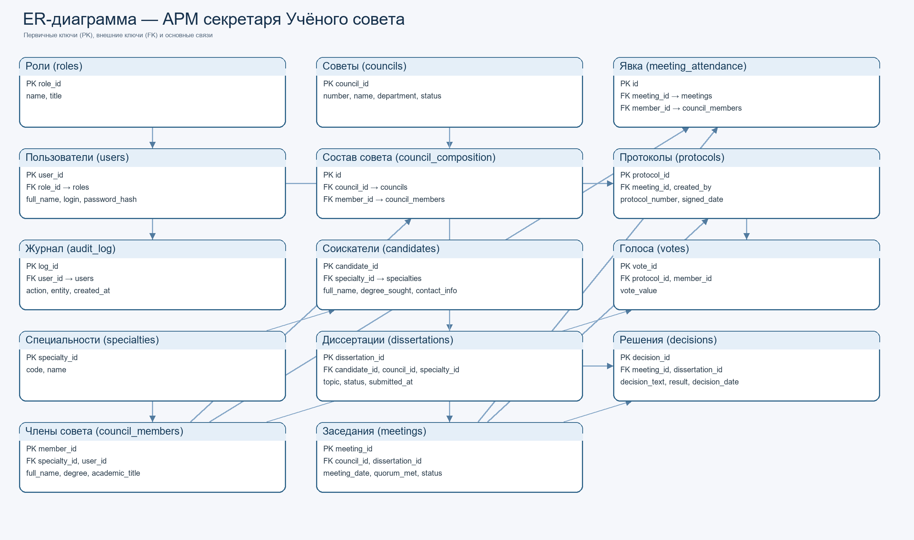

# Информационная система: АРМ секретаря Учёного совета

**Курс:** Прикладное программное обеспечение информационных систем (2026 г.)
**Автор:** Қаһарман Нұрмұхаммед
**Группа:** укажите номер группы перед сдачей

## 1. Описание предметной области

Система помогает секретарю учёного совета вести состав советов, специальности, данные соискателей и диссертационные дела. В ней планируются заседания, фиксируется явка, автоматически проверяется кворум и оформляется решение по результатам голосования. В предметной области участвуют секретарь, члены совета и администратор.

В папке проекта сохранена первоначальная версия приложения на Flask и SQLite (`app.py`, `services.py`, `templates/`). Для лабораторных работ добавлена модульная версия на FastAPI, SQLModel и Streamlit (`app/`). Первоначальная версия и её база `arm.db` оставлены без изменений; новая версия использует отдельную базу `database.db` и при первом локальном запуске переносит в неё данные из старой базы, если файл `database.db` ещё пуст.

## 2. Архитектура данных (ER-диаграмма)



Исходник диаграммы в формате Mermaid: [`docs/er_diagram.mmd`](docs/er_diagram.mmd).

В модели SQLModel описаны 14 сущностей: `Role`, `User`, `Specialty`, `CouncilMember`, `Council`, `CouncilComposition`, `Candidate`, `Dissertation`, `Meeting`, `MeetingAttendance`, `Protocol`, `Vote`, `Decision`, `AuditLog`.

Связи: у роли много пользователей; специальность связана со многими членами совета и соискателями; совет объединяет членов через таблицу состава; соискатель может иметь несколько диссертационных дел; совет и диссертация связаны с заседаниями; заседание хранит явку, протокол и решение; протокол содержит голоса; действия пользователей записываются в журнал аудита.

## 3. Технологический стек

- **Backend:** Python 3.12+, FastAPI, Uvicorn
- **Database / ORM:** SQLite, SQLModel (SQLAlchemy)
- **Frontend UI:** Streamlit, Requests
- **DevOps / Инфраструктура:** Docker, Docker Compose
- **Тесты:** pytest, FastAPI TestClient, httpx
- **AI-tools:** Cursor или VS Code с Python и GitHub Copilot Chat; примеры учебных промптов находятся в [`docs/ai_prompts.md`](docs/ai_prompts.md).

Структура проекта:

```text
app/
  database/       SQLModel-модели, подключение и демо-данные
  routers/        REST API для справочников, дел и заседаний
  frontend/       Streamlit-интерфейс
  main.py         FastAPI-приложение
tests/
  test_api.py     интеграционные тесты API
docs/             ER-диаграмма и учебные материалы
Dockerfile        образ backend
Dockerfile.frontend
docker-compose.yml
requirements.txt
```

## 4. Локальный запуск

Установите Python 3.10+ и создайте виртуальное окружение:

```powershell
py -3 -m venv .venv
.venv\Scripts\Activate.ps1
python -m pip install -r requirements.txt
```

Запустите backend в первом терминале:

```powershell
python -m uvicorn app.main:app --reload
```

Запустите интерфейс Streamlit во втором терминале:

```powershell
python -m streamlit run app/frontend/ui.py
```

Откройте интерфейс `http://127.0.0.1:8501`, документацию API — `http://127.0.0.1:8000/docs`. При первом запуске создаются таблицы. Если рядом есть старая `arm.db`, её данные переносятся в новую базу; иначе заполняются демонстрационные данные. Локальная база `database.db` не попадает в Git.

## 5. Запуск через Docker Compose

Предварительно установите Docker Desktop с поддержкой Docker Compose. В корне проекта выполните:

```powershell
docker compose up --build
```

- **Интерфейс:** http://localhost:8501
- **Swagger UI:** http://localhost:8000/docs

Данные SQLite хранятся в именованном Docker-томе `database_data` и переживают остановку контейнеров. Чтобы остановить сервисы, нажмите `Ctrl+C`, затем выполните `docker compose down`. Для демонстрационной локальной работы порты опубликованы только на `127.0.0.1`.

## 6. Запуск тестов

```powershell
pytest
```

Интеграционные проверки покрывают CRUD членов совета, валидацию, работу с БД, проверку кворума и оформление протокола. Для исходной версии Flask сохранён отдельный учебный набор проверок: `python test_app.py`.

### Мобильный этап (лабораторные №9–11)

Flutter SDK в рабочей среде отсутствует, поэтому для мобильного этапа подготовлен адаптивный PWA-клиент. Он устанавливается на главный экран телефона и использует тот же REST API и SQLite-базу проекта. Это мобильный веб-клиент, а не Flutter APK.

Запуск: включите backend командой выше, затем откройте `http://127.0.0.1:8000/mobile/`. На телефоне и компьютере в одной Wi-Fi сети запустите сервер с `--host 0.0.0.0`, узнайте локальный IP компьютера и откройте `http://<IP-компьютера>:8000/mobile/`; для установки выберите в браузере «Добавить на главный экран». Не публикуйте такой запуск в общедоступной сети: авторизация API не реализована.

- Архитектура и маршрут пользователя: [`docs/mobile_architecture.mmd`](docs/mobile_architecture.mmd), [`docs/mobile_user_flow.mmd`](docs/mobile_user_flow.mmd).
- Отчёт, тест-сценарии и план демонстрации: [`docs/mobile_lab_report.md`](docs/mobile_lab_report.md).

### Лабораторная работа №8

- Отчёт с архитектурой, интеграционными и защитными сценариями: [`docs/lab8_report.md`](docs/lab8_report.md).
- Нагрузочный сценарий Locust (только чтение): [`tests/load/locustfile.py`](tests/load/locustfile.py).
- GitHub Actions запускает `pytest` и Bandit при `push` и `pull_request`: [`.github/workflows/tests.yml`](.github/workflows/tests.yml).
- Установить дополнительные инструменты: `python -m pip install -r requirements-lab8.txt`.
- Запустить статический анализ: `bandit -r app -ll`.
- Запустить нагрузочную проверку и заполнить таблицу в отчёте можно командами из `docs/lab8_report.md`.

## 7. Примеры входных данных

Новая версия автоматически добавляет демонстрационные данные в пустую базу: роли и пользователи, четыре специальности, советы и их состав, соискателей, дела, заседания, явку, голоса, протоколы и решения. API пока предназначен для локальной учебной демонстрации и не реализует аутентификацию пользователей; не публикуйте его в общедоступной сети без добавления проверки доступа.

## 8. Контрольные вопросы к защите

1. **Зачем нужен `venv`?** Он изолирует версии библиотек проекта от других Python-приложений. Без него зависимости могут конфликтовать.
2. **Для чего нужен `.gitignore`?** Он исключает локальные окружения, базы и секреты из Git, чтобы не передавать лишние файлы и конфиденциальные данные.
3. **Какова роль ИИ-инструментов?** Они помогают создавать шаблоны и проверять код, но результат нужно читать и проверять тестами: генерация может содержать ошибки или небезопасные решения.
4. **Что такое ветка Git?** Это независимая линия разработки. В командной работе изменения обычно готовят в отдельной ветке и проверяют перед слиянием с `main`.
5. **Чем отличаются `commit` и `push`?** `commit` сохраняет снимок изменений локально; `push` отправляет локальные коммиты в удалённый репозиторий.
6. **Что такое ORM?** ORM связывает классы Python с таблицами базы. Поле `specialty_id` хранит внешний ключ, а `Relationship` позволяет работать со связанной записью как с объектом.
7. **Зачем нужны seed-данные?** Они создают воспроизводимую демо-базу, на которой удобнее показывать и проверять сценарии приложения.
8. **Что делает FastAPI `Depends`?** Подключает общие зависимости, например новую сессию базы данных на время обработки запроса.
9. **Что такое кворум в проекте?** Не менее двух третей состава совета должны присутствовать, включая как минимум трёх докторов наук по специальности диссертации.
10. **Зачем нужны Docker и Compose?** Docker упаковывает приложение в изолированные образы, а Compose запускает backend и интерфейс как согласованный набор сервисов.
11. **Что проверяют интеграционные тесты?** Они отправляют HTTP-запросы тестовому приложению и проверяют ответы API без запуска отдельного сервера Uvicorn.
