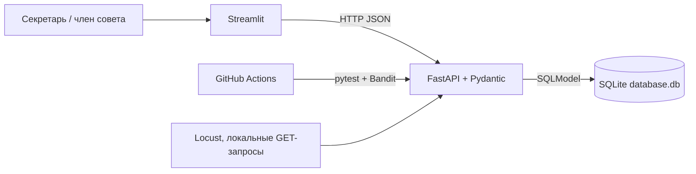

# Лабораторная работа №8 — отчёт

**Тема:** Комплексное интеграционное, нагрузочное и безопасностное тестирование информационной системы. Автоматизация контроля качества.

**Проект:** АРМ секретаря Учёного совета  
**Автор:** Қаһарман Нұрмұхаммед  
**Дата выполнения:** __________________

## 1. Цель

Проверить взаимодействие интерфейса, REST API и SQLite; выявить ошибки API и ограничения безопасности; измерить отклик на локальную нагрузку; автоматизировать тесты через GitHub Actions.

## 2. Архитектура системы



| Компонент | Роль | Возможные ошибки | Проверка |
|---|---|---|---|
| Streamlit UI | Ввод и просмотр данных | API недоступно; некорректное состояние формы | Ручной запуск UI и просмотр страниц |
| FastAPI | Маршруты и бизнес-правила | Невалидные поля; неизвестный ID или нарушение правил кворума | pytest через TestClient |
| SQLite/SQLModel | Хранение и связи | Нарушение внешнего ключа; незавершённая транзакция | Тест внешнего ключа и rollback |
| Валидация API | Проверка входного JSON | Пустое имя; неподдерживаемое значение degree | Ожидается HTTP 422 |
| GitHub Actions | Автоматическая проверка изменений | Зависимости не установились; тесты/анализатор завершились ошибкой | Статус workflow в GitHub Actions |

**Потоки данных:** UI отправляет HTTP JSON в FastAPI; Pydantic проверяет поля; маршрут читает или меняет SQLite через SQLModel; FastAPI возвращает JSON. GitHub Actions отдельно устанавливает зависимости, запускает pytest и Bandit. Locust создаёт только GET-нагрузку на запущенный локальный API.

**Интеграционные границы:** UI → API; API → SQLite; API → правила состава совета, явки, кворума и протокола; GitHub Actions → набор тестов.

## 3. Инструменты

Python, FastAPI, SQLModel, SQLite, Streamlit, pytest/TestClient, Locust, Bandit, GitHub Actions.

## 4. Интеграционные и автоматические тесты

Запуск: `pytest -v`. Набор проверяет чтение и создание записей, изменение и удаление члена совета, фильтрацию, валидацию, ошибки неизвестных ID, кворум, оформление протокола и откат транзакции при нарушении внешнего ключа.

| Сценарий | Ожидаемый результат | Результат запуска |
|---|---|---|
| GET списка членов совета | 200 и список | Прошло |
| POST нового члена совета | 201 и созданная запись | Прошло |
| PUT и DELETE члена совета | 200, затем 204 | Прошло |
| Невалидный JSON/degree | 422 | Прошло |
| Несуществующая специальность или ID | 404, запись не создана | Прошло |
| Явка вне состава совета | 422 | Прошло |
| Протокол без кворума | 409 | Прошло |
| Нарушение внешнего ключа в БД | rollback, число записей не меняется | Прошло |

**Автоматический запуск:** `pytest -v` — 14 тестов пройдены на временной SQLite-базе; рабочая база приложения не менялась.

## 5. Нагрузочное тестирование

Сценарий Locust выполняет только чтение: `GET /health`, `GET /api/members`, `GET /api/councils`. Перед запуском поднимите backend на `http://127.0.0.1:8000`, затем в отдельном терминале выполните для каждого набора:

```powershell
python -m locust -f tests/load/locustfile.py --host http://127.0.0.1:8000 --users 5 --spawn-rate 1 --run-time 1m --headless --csv load-results/5-users
python -m locust -f tests/load/locustfile.py --host http://127.0.0.1:8000 --users 20 --spawn-rate 2 --run-time 2m --headless --csv load-results/20-users
python -m locust -f tests/load/locustfile.py --host http://127.0.0.1:8000 --users 50 --spawn-rate 5 --run-time 3m --headless --csv load-results/50-users
python -m locust -f tests/load/locustfile.py --host http://127.0.0.1:8000 --users 100 --spawn-rate 10 --run-time 3m --headless --csv load-results/100-users
```

| Пользователи | Длительность | Среднее время ответа | 95-й перцентиль | Запросов/с | Запросы / ошибки |
|---:|---:|---:|---:|---:|---:|
| 5 | 1 мин | 3.57 мс | 5 мс | 4.82 | 281 / 0 |
| 20 | 2 мин | 3.69 мс | 6 мс | 19.13 | 2 267 / 0 |
| 50 | 3 мин | 4.74 мс | 9 мс | 48.62 | 8 667 / 0 |
| 100 | 3 мин | 5.67 мс | 11 мс | 96.91 | 17 340 / 0 |

**Вывод по нагрузке:** во всех сценариях ошибок не было. При росте с 5 до 100 пользователей среднее время ответа выросло с 3.6 до 5.7 мс, пропускная способность — с 4.8 до 96.9 запроса/с. Для этого read-only сценария заметного ухудшения API не выявлено. CPU и RAM отдельно не записывались; их нельзя достоверно восстановить по Locust CSV. Сводные CSV сохранены в `docs/lab8_results/`. Проверка проводилась только на локальном API.

## 6. Проверки безопасности

| Сценарий | Ожидаемый результат | Результат |
|---|---|---|
| Пустое/слишком короткое имя и неподдерживаемый degree | 422; запись не создаётся | Проверяется pytest |
| Несуществующий связанный ID | 404; запись не создаётся | Проверяется pytest |
| Явка участника вне состава совета | 422 | Проверяется pytest |
| Оформление протокола без кворума | 409 | Проверяется pytest |
| Утечка `password_hash` в ответе API | Поля нет в публичном ответе | Проверяется pytest |
| Статический анализ Bandit | Нет найденных high/medium проблем | `bandit -r app -ll`: 0 medium/high; 3 low ниже порога `-ll` |

**Ограничение:** текущая учебная версия не содержит авторизации и ролей на API-маршрутах. Поэтому сценарий «запрос без авторизации → 401/403» применить нельзя: сейчас API не защищён логином. Для реального использования нужно добавить аутентификацию и проверку ролей. Не размещать API открыто в интернете.

## 7. CI/CD

Workflow `.github/workflows/tests.yml` запускается на `push` и `pull_request`: устанавливает Python и зависимости, выполняет `pytest -v` и `bandit -r app -ll`. Результат проверки появится во вкладке **Actions** репозитория.

**Результат:** локальные pytest и Bandit прошли; GitHub Actions также завершился успешно (14 тестов + Bandit): [запуск CI](https://github.com/Ualli25/APM--/actions/runs/44473167950).

## 8. Найденные дефекты и исправления

- Добавлены GET/PUT/DELETE маршруты для членов совета, чтобы закрыть CRUD-проверки.
- Создание заседания теперь проверяет существование совета и связанного дела и возвращает 404 вместо ошибки базы данных.
- Добавлены интеграционные проверки валидации и транзакционного rollback.
- Авторизация отсутствует; это зафиксировано как ограничение, требующее исправления перед эксплуатацией.

## 9. Результат и заключение

Локально и в GitHub Actions прошли 14 автоматических проверок; Bandit не сообщил проблем средней и высокой важности; все четыре нагрузочных сценария завершились без ошибок. Время ответа постепенно выросло вместе с количеством пользователей. CPU/RAM отдельно не измерялись. Главный найденный риск — API не имеет аутентификации и разграничения ролей.

## 10. Контрольные вопросы

1. Unit-тест проверяет отдельную функцию, интеграционный — работу связанных компонентов.
2. HTTP-коды описывают результат запроса: 2xx — успех, 4xx — ошибка запроса/доступа, 5xx — ошибка сервера.
3. Response Time — время ответа; Throughput — число запросов за единицу времени.
4. Транзакция группирует изменения; rollback отменяет изменения при ошибке до фиксации.
5. pytest автоматизирует повторяемые проверки и сообщает, какое ожидание нарушено.
6. CI/CD автоматически запускает проверки при изменениях кода.
7. Автотесты не доказывают отсутствие всех ошибок и требуют сценариев для рисков.
8. Сейчас в проекте нет входа и разграничения прав, поэтому закрытые API-ресурсы не реализованы.
